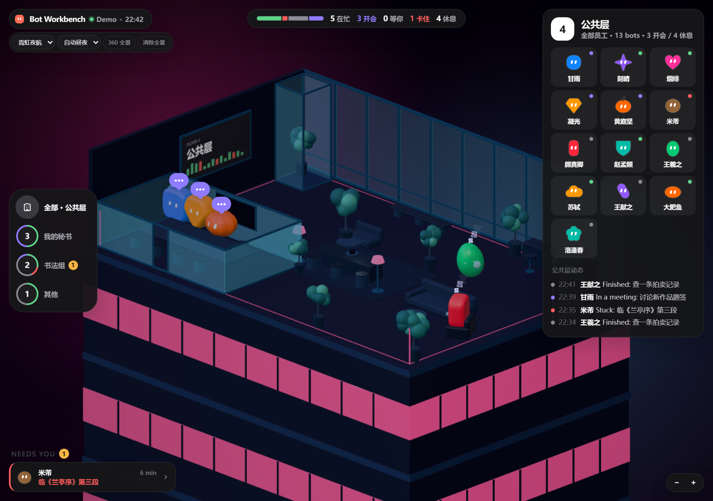
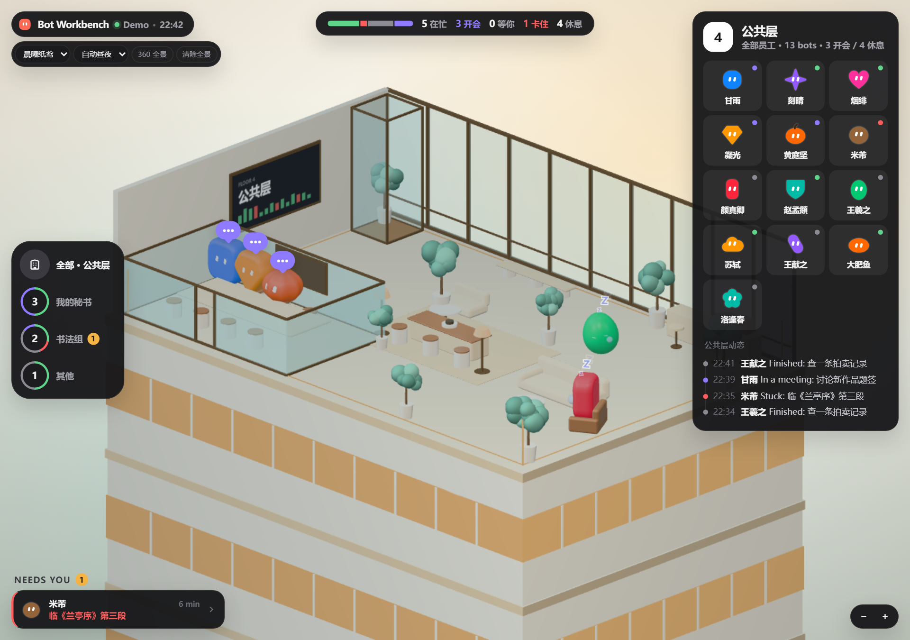
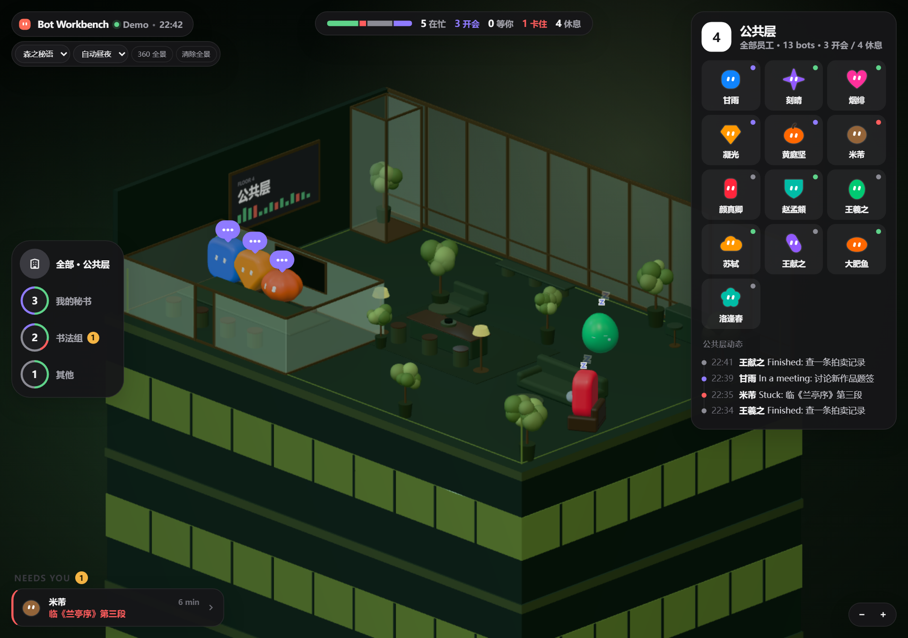

# Bot Workbench

**缁?Tobs Bot 妯″紡鐢ㄧ殑寮€婧?3D 宸ヤ綔鍙般€?*

瀹炴椂 Bot 鐘舵€併€佽鑹插崱銆侀」鐩崗浣溿€佷細璁邯瑕併€佸畾鏃朵换鍔★紝浠ュ強涓€涓細鍔ㄣ€佷細鍚冮浂椋熴€佷細婧滆揪鐨?3D 鍔炲叕瀹ゃ€?
瀹屽叏寮€婧愩€佸厤璐广€佹棤閬ユ祴銆傚彧璇?Tobs 鏈湴鏁版嵁锛屼笉鍐欐暟鎹簱銆?


## 鍔熻兘

- **3D 鍔炲叕瀹?*锛?3 涓?Bot銆佹ゼ灞傘€佸伐浣嶃€佷細璁銆佷紤鎭尯
- **瀹炴椂鐘舵€?*锛氬湪蹇?/ 寮€浼?/ 绛変綘 / 鍗′綇 / 浼戞伅銆佸綋鍓嶄换鍔°€乼oken 鐢ㄩ噺
- **瑙掕壊鍗?*锛氬爢鍙犲睍寮€锛屾墦寮€绉佽亰銆侀個璇峰埌浼氳瀹?- **椤圭洰**锛氶」鐩兢銆佹案涔?涓存椂鎴愬憳銆佷换鍔℃澘
- **浼氳**锛氫复鏃剁兢銆佺邯瑕併€佹ā鍨嬮€夋嫨
- **瀹氭椂浠诲姟**锛氭煡鐪嬨€佸垹闄?- **浜斿椋庢牸**锛氭櫒鏇︾焊楦?/ 闇撹櫣澶滆埅 / 妫箣绉樿 / 姘村ⅷ浜戞父 / 灞辨渤鏈遍槞
- **鏄煎鑷畾涔?*锛氳嚜鍔ㄣ€佺櫧澶┿€侀粦澶?- **360 鍏ㄦ櫙**锛氬彲绮樿创/閫夋嫨鑷繁鐨勭瓑璺濇煴鐘跺叏鏅浘浣滀负鑳屾櫙
- **浼戞伅鍖哄姩浣?*锛氱潯瑙夈€佸悆闆堕銆佸枬鍜栧暋銆佺湅涔︺€佷几鎳掕叞銆佹簻杈?- 3D 娓叉煋鍏ㄩ儴鏈湴鎵撳寘锛屼笉渚濊禆 CDN





## 瀹夎

闇€瑕侊細

- DeepSeek Harness锛圖SH锛?- Tobs `@botharness/tobs` 1.6.x
- Bot 妯″紡閲屾湁 Bot

### 鏂瑰紡涓€锛欸itHub Releases锛堟帹鑽愶級

1. 浠?Releases 涓嬭浇 `bot-workbench-0.1.3.tgz`
2. 鍦?DSH profile 鐩綍瀹夎锛?
```bash
pnpm add file:/absolute/path/to/bot-workbench-0.1.3.tgz
```

3. 鎶?`bot-workbench` 鍔犲叆 profile 鐨?bundles锛?
```json
{
  "dsh": {
    "profile": {
      "bundles": ["...", "bot-workbench"]
    }
  }
}
```

4. 閲嶅惎 DSH銆?
涔熷彲浠ョ洿鎺ュ湪 DSH 閲岋細

```text
plugin_manager install_bundle
target: file:/absolute/path/to/bot-workbench-0.1.3.tgz
```

### 鏂瑰紡浜岋細浠庝粨搴撳畨瑁?
```bash
git clone https://github.com/yangmu-dot/bot-workbench.git
cd <DSH profile directory>
pnpm add file:/absolute/path/to/bot-workbench
```

鐒跺悗鎶?`bot-workbench` 鍔犲叆 bundles锛岄噸鍚?DSH銆?
## 浣跨敤

閲嶅惎鍚庤繘鍏?**Bot 妯″紡**锛?
- 鎵撳紑闈㈡澘鑿滃崟 鈫掋€岀洃鎺у銆?- 鐐广€屽姙鍏銆嶈繘鍏?3D 鍔炲叕瀹?- 宸︿笂瑙掑垏鎹㈤鏍笺€佹樇澶?- 銆?60 鍏ㄦ櫙銆嶅彲浠ョ矘璐磋嚜宸辩殑鍏ㄦ櫙鍥?- 鐐?Bot 鐪嬭鎯咃紝鎷栧姩鏃嬭浆鍔炲叕瀹?
## 鏁版嵁涓庨殣绉?
- 鍙 `~/.dsh/botharness/botharness.db` 鍜?Bot 浼氳瘽鏃ュ織
- 涓嶅啓 Tobs 鏁版嵁搴?- 涓嶄笂浼犳暟鎹€佷笉璋冪敤澶栭儴澶╂皵/缁熻鏈嶅姟
- 浼氳銆侀」鐩€佽缃繚瀛樺湪 `~/.dsh/bot-workbench/`
- 3D 闈欐€佽祫婧愰殢鎻掍欢瀹夎锛屼笉璇锋眰 CDN

## 鐩綍

```text
index.js                 Host API / 闈欐€佽祫婧?client.js                DSH Web 瀹㈡埛绔?cordis.patch.yml         bundle 鍏ュ彛
office/                  3D 鍔炲叕瀹?  index.html
  src/
  vendor/                鏈湴 Three.js
  styles.css
locale/                  涓嫳鏂囧厓鏁版嵁
portraits/               鑷畾涔夊ご鍍?docs/screenshots/        README 鎴浘
```

## 寮€鍙?
- 鏀?`index.js` 闇€瑕侀噸鍚?Host
- 鏀?`client.js` 鍚庡埛鏂伴〉闈紱瀹㈡埛绔彃浠跺彲鑳介渶瑕侀噸鍚?DSH
- 鏀?`office/` 鏄函闈欐€佽祫婧愶紝鍏虫帀鍔炲叕瀹ら噸寮€鍗冲彲
- 3D 浣跨敤 Three.js 0.170锛屽凡鍐呯疆鍦?`office/vendor/`

## DSH 鎻掍欢甯傚満

甯傚満鏉＄洰鍦?[`market/bot-workbench.yml`](market/bot-workbench.yml)銆侱SH 绀惧尯甯傚満闇€瑕佸叕寮€浠撳簱婊?1 澶╁悗锛屽悜 `awesome-dsh-plugin` 鎻愪氦鏀跺綍 PR锛涘鏍搁€氳繃鍚庡啀鐢卞競鍦虹储寮曟敹褰曘€?
## License

MIT銆傝 [LICENSE](LICENSE)銆?
鎴浘浣跨敤 Demo 鏁版嵁锛屼笉鍖呭惈鐪熷疄鐢ㄦ埛瀵硅瘽鎴栫瀵嗗唴瀹广€?