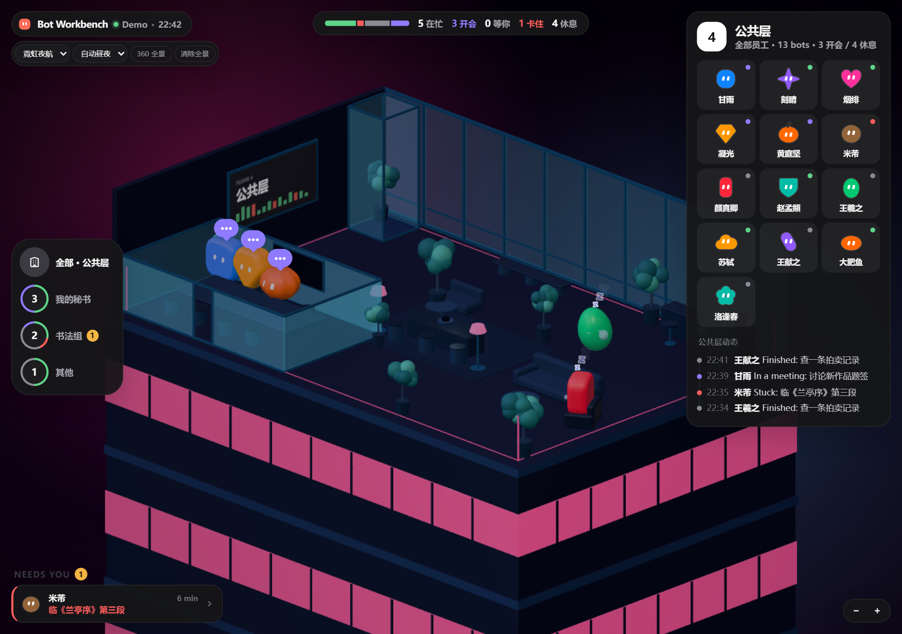
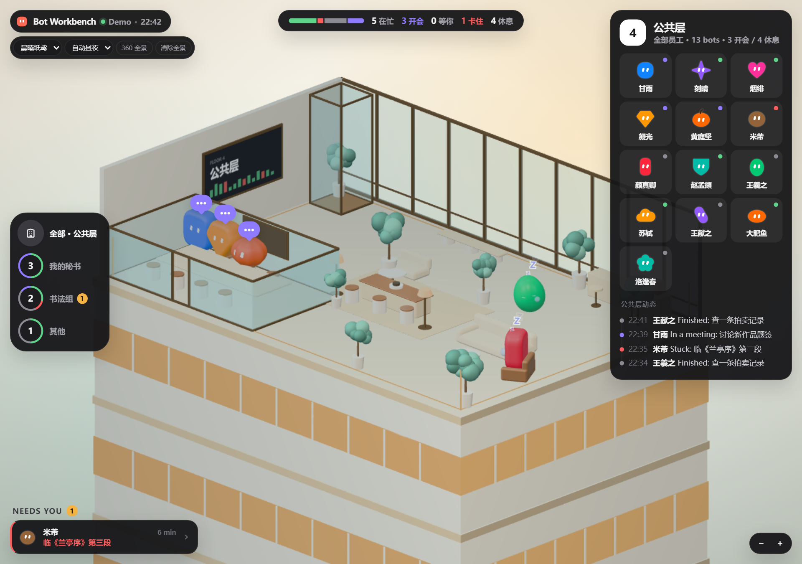

# Bot Workbench · 产品介绍

> **把 AI Bot 从列表，变成一间看得见、走得进去的办公室。**

Bot Workbench 是运行在 DeepSeek Harness（DSH）里的开源 Tobs Bot 模式工作台。  
它把 Bot 的实时状态、任务、角色、项目、会议和休息行为，放进一个可旋转、可点击的 3D 办公室。

- 开源免费
- MIT 协议
- 只读 Tobs 本地数据
- 无遥测、无外部统计
- 不依赖 CDN，安装即可用



---

## 一、为什么做这个

Bot 模式里，Bot 只是消息列表中的一行名字：

- 谁在忙、谁卡住、谁在等你，要翻状态才知道
- 任务上下文、token、记忆散在不同面板
- 开会要手动建群、拉人、整理纪要
- 多 Bot 协作没有项目层，任务和负责人容易乱
- 角色卡和数据展示偏工具化，缺少“团队在办公”的空间感

Bot Workbench 的目标不是再做一个仪表盘，而是给 Bot 一个**可进入的工作空间**：

> 你能看见他们坐在哪、在做什么、是不是在等你；  
> 能点开一个人私聊，也能把几个人拉进会议室；  
> 能把复杂任务立成项目，而不是在一堆聊天里失忆。

---

## 二、核心能力

### 1. 3D 办公室

- 公共层、团队楼层、工位、会议室、休息区
- 每个 Bot 有自己的角色外观、颜色和状态气泡
- `working` 自动回工位，休息去休息区
- 点击 Bot 查看当前任务、上下文、token、最近动态
- 可以拖动旋转、缩放，查看整栋办公室



### 2. 五套视觉风格

| 风格 | 气质 |
| --- | --- |
| 晨曦纸鸢 | 暖白、青瓷柔光、纸感 |
| 霓虹夜航 | 深紫黑、品红侧光、夜色 |
| 森之秘语 | 苔藓绿、木色、安静 |
| 水墨云游 | 宣纸灰白、墨色留白、朱红 |
| 山河朱阙 | 朱红、鎏金、庄重 |

- 自动按时间切换
- 也可以手动锁定
- 支持自动 / 白天 / 黑夜独立设置
- 支持上传或粘贴自己的 360 全景作为背景

### 3. 实时状态与角色卡

- 在忙 / 开会 / 等你 / 卡住 / 休息
- 当前回合、工具调用、上下文占用、今日 token
- 角色卡堆叠展开，点开即可：
  - 打开私聊
  - 邀请到会议室
- 任务卡支持筛选和查看

### 4. 会议室

- 3D 办公室右下角「＋ 会议室」
- 点击 Bot 的「邀请到会议室」
- 多选至少 2 位 Bot 后创建
- **创建时立刻建立临时会议群**，不强制先发言
- 不发言也可以先听、先看，或直接结束
- 支持移出成员、发送消息、结束会议
- 会议结束自动解散临时群
- 支持生成会议纪要

### 5. 项目

复杂任务可以从「会议立项」或直接创建项目：

- 自动创建项目群
- 参会人 / 初始成员默认永久成员
- 后来邀请默认临时成员
- 永久 / 临时可随时切换
- 可以随时拉入或移出
- 项目结束：临时成员自动移出，永久成员和项目群保留
- 项目任务支持负责人、负责人历史

### 6. 休息区不是只会睡觉

Bot 在休息区会随机：

- 睡觉
- 吃零食
- 喝咖啡
- 看书
- 伸懒腰
- 东张西望
- 换位置溜达

夜间优先休息，不梦游；白天可以到处转转。

### 7. 定时任务与纪要

- 查看、删除 Tobs 定时任务
- 会议纪要 Markdown 导出
- 纪要模型可选默认 / 指定模型 / 自定义 API
- 会议原文保存在本地

---

## 三、适合谁

- 同时管理多个 Tobs Bot 的人
- 想让 Bot 团队更有“在场感”的人
- 经常用会议 / 项目推进多 Bot 协作的人
- 想给 Bot 做角色卡、头像和休息区行为的人
- 喜欢本地优先、开源、可改的人

---

## 四、安装

### 环境

- DeepSeek Harness
- Tobs `@botharness/tobs` 1.6.x
- Bot 模式里有 Bot

### 从 Release 安装

1. 下载：

```text
https://github.com/yangmu-dot/bot-workbench/releases/download/v0.1.3/bot-workbench-0.1.3.tgz
```

2. 在 DSH profile 中安装：

```bash
pnpm add https://github.com/yangmu-dot/bot-workbench/releases/download/v0.1.3/bot-workbench-0.1.3.tgz
```

3. 把 `bot-workbench` 加入 profile 的 `dsh.profile.bundles`
4. 重启 DSH
5. 进入 Bot 模式 → 面板菜单 →「监控室」

### 从源码

```bash
git clone https://github.com/yangmu-dot/bot-workbench.git
cd <DSH profile>
pnpm add file:/absolute/path/to/bot-workbench
```

---

## 五、隐私与数据

Bot Workbench 默认只读：

- `~/.dsh/botharness/botharness.db`
- Bot 会话日志
- Tobs 官方 `botPresentation` 服务

不会：

- 写 Tobs 数据库
- 上传聊天记录
- 调用外部天气 / 统计服务
- 请求 CDN
- 收集遥测

插件自己的数据保存在：

```text
~/.dsh/bot-workbench/
```

包括会议、项目、设置和本地纪要。

---

## 六、技术架构

```text
index.js                 Host API / 静态资源服务
client.js                DSH Web 客户端
cordis.patch.yml         bundle 入口
office/                  3D 办公室（Three.js）
  index.html
  src/
  vendor/                本地 Three.js
  styles.css
locale/                  中英文元数据
portraits/               自定义头像
```

- 3D：Three.js 0.170，已本地打包
- 状态：Tobs 只读快照
- 会议：Tobs bridge（建群 / 邀请 / 发消息 / 解散）
- 数据：SQLite 只读 + 本地 JSON
- 无构建步骤，`pnpm pack` 直接安装

---

## 七、路线图

- DSH 社区插件市场收录
- 更丰富的项目任务派发（直接生成 Tobs Assignment）
- 会议室 3D 内更完整的会议 UI
- 自定义角色动作与道具
- 更多主题背景 / 用户全景预设
- 移动端布局优化

---

## 八、License

MIT。完全开源、免费，可商用、可修改、可分发。

Copyright (c) 2026 Bot Workbench contributors

---

## 九、一句话总结

> **Bot Workbench 不是让你多一个后台，而是让 Bot 团队真的“在办公室里上班”。**
